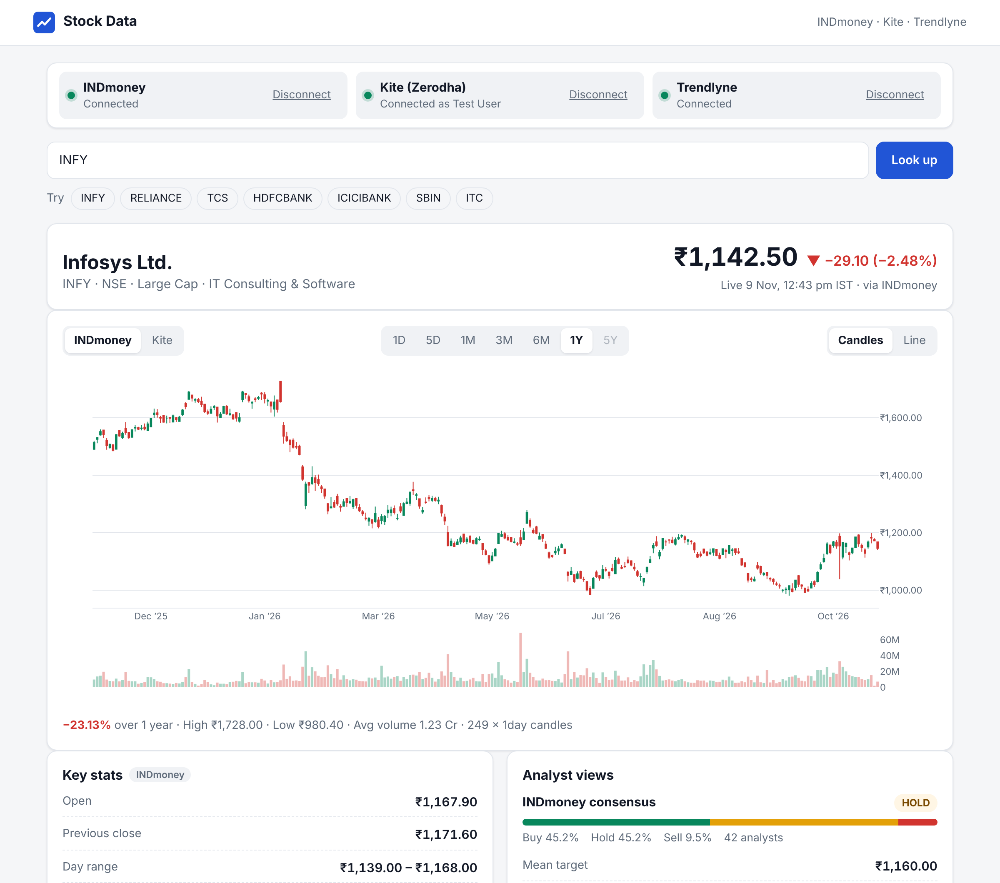

# Stock Data (Python)

A Flask web app that pulls Indian stock data from **INDmoney**, **Kite (Zerodha)** and
**Trendlyne** through their official MCP servers, and shows it as charts, key stats,
analyst views, research scores and news, with CSV export and a JSON API.



## What you get

- **Prices and charts.** Candlestick or line charts for 1D to 1Y from INDmoney, and 1D to 5Y from Kite, with volume, a price-history table and **CSV download**.
- **Quote and key stats.** Live price, day change, day and 52-week range, volume, market cap and circuit limits.
- **Analyst views.** INDmoney's consensus and target price, and Trendlyne's broker summary.
- **Research from Trendlyne.** Durability, Valuation and Momentum scores; fundamentals; technicals (RSI, MFI, moving averages); returns from 1 week to 10 years; SWOT; and the PE valuation check.
- **News and exchange filings** from Trendlyne.
- **A JSON API** you can use from your own scripts (see below).

## How it connects

The app is an [MCP](https://modelcontextprotocol.io) client, built on the official
`mcp` Python SDK. It keeps one session open per data source. Each source signs you in
on its own page, and the app only ever reads data.

| Source | Server | How you sign in | Notes |
| --- | --- | --- | --- |
| INDmoney | `https://mcp.indmoney.com/mcp` | INDmoney's page (mobile, OTP, MPIN), via OAuth | Free for INDmoney users. Read-only by design. |
| Kite (Zerodha) | `https://mcp.kite.trade/mcp`, Zerodha's hosted server | A Kite login link, opened in a new tab | No API key needed. Kite ends sessions daily, so you log in once a day. |
| Trendlyne | Your personal URL from Trendlyne | Built into the URL, or OAuth if Trendlyne asks | Needs a Trendlyne MCP subscription. Its price-history tool needs the MCP Max or Ultra plan, so charts come from INDmoney or Kite. |

Logins are saved in `instance/tokens/` (readable by your user only), so restarting the
app doesn't ask again until a token expires. **Disconnect** deletes the saved login.

## Quick start

You need Python 3.10 or newer.

```bash
git clone https://github.com/SeetharamanM/Stock-Data-Python.git
```

```bash
cd Stock-Data-Python
```

```bash
python -m venv .venv
```

```bash
source .venv/bin/activate
```

(On Windows run `.venv\Scripts\activate` instead.)

```bash
pip install -r requirements.txt
```

```bash
cp .env.example .env
```

Edit `.env` and paste your Trendlyne MCP URL into `TRENDLYNE_MCP_URL`. Then start the app:

```bash
python app.py
```

Open **http://localhost:8000** and connect your accounts from the bar at the top.

1. **INDmoney:** click **Log in**, sign in on INDmoney's page and approve. You come back to the app, connected.
2. **Kite:** click **Log in**. Kite's login opens in a new tab; sign in there, then return to the app tab, which updates by itself. Do this once a day.
3. **Trendlyne:** connects automatically once `TRENDLYNE_MCP_URL` is set. Copy the URL from Trendlyne (profile menu > MCP).

Then search for a company or NSE symbol (`Infosys`, `INFY`, `RELIANCE`…). Switch the
price source between INDmoney and Kite above the chart.

Open the app at the address in `PUBLIC_BASE_URL` (default `http://localhost:8000`):
logins redirect back to that address.

## Settings

Put these in `.env` or set them as environment variables.

| Variable | Default | Meaning |
| --- | --- | --- |
| `TRENDLYNE_MCP_URL` | *(empty)* | Your Trendlyne MCP URL. Trendlyne is off until you set it. |
| `INDMONEY_MCP_URL` | `https://mcp.indmoney.com/mcp` | Set it to an empty value to turn INDmoney off. |
| `KITE_MCP_URL` | `https://mcp.kite.trade/mcp` | Point it at a [self-hosted Kite MCP server](https://github.com/zerodha/kite-mcp-server) if you run one with your own Kite Connect key. |
| `HOST`, `PORT` | `127.0.0.1`, `8000` | Where the app listens. |
| `PUBLIC_BASE_URL` | `http://localhost:<PORT>` | The address you open the app at; used for login redirects. |
| `ALLOWED_HOSTS` | *(empty)* | Extra `host:port` names allowed to reach the app, comma separated. |
| `DATA_DIR` | `instance` | Where saved logins are kept. |
| `FLASK_DEBUG` | `0` | Set to `1` for Flask's debug mode. |

## Chart ranges

| Range | INDmoney | Kite |
| --- | --- | --- |
| 1D | 5-minute candles | 5-minute candles |
| 5D | 15-minute candles | 15-minute candles |
| 1M, 3M, 6M, 1Y | daily candles | daily candles |
| 5Y | not available | daily candles |

INDmoney returns at most 250 candles per request, keeps minute candles for 7 days and
keeps daily candles for 1 year. The chart has no gaps for weekends or holidays, and it
keeps special sessions such as Diwali Muhurat trading.

## JSON API

While the app runs, you can fetch the same data yourself:

```text
GET  /api/search?q=infosys
GET  /api/quote/INFY?source=indmoney            (or source=kite)
GET  /api/history/INFY?source=kite&range=5y     (range: 1d 5d 1m 3m 6m 1y 5y)
GET  /api/history/INFY?source=kite&range=5y&format=csv
GET  /api/insights/INFY                          (Trendlyne research)
GET  /api/news/INFY                              (Trendlyne news and filings)
GET  /api/providers                              (connection status)
```

Errors come back as JSON with a `code`. For example, `login_required` (HTTP 401) includes
an `auth_url` to log in at. The other codes are `not_found`, `unsupported`, `plan_limit`,
`not_configured` and `unavailable`.

For example, to load five years of Kite candles into pandas:

```python
import pandas as pd

prices = pd.read_csv("http://localhost:8000/api/history/INFY?source=kite&range=5y&format=csv", parse_dates=["Date"])
```

## Security

- The app listens on `127.0.0.1` only. It holds access to your accounts, so don't expose it to a network.
- Saved logins live in `instance/tokens/`. That folder is git-ignored and the files are readable by your user only.
- The app answers only requests addressed to it, which blocks DNS-rebinding attacks.
- Requests that change state must come from its own page, which blocks cross-site requests.
- Pages are served with a strict Content-Security-Policy, and the chart library is pinned with a Subresource Integrity hash.
- It only calls read-only data tools. INDmoney's MCP server cannot trade, and Zerodha's hosted Kite MCP server excludes trading tools.

## Troubleshooting

- **"Could not reach mcp.indmoney.com"** (or another host): check your internet connection, proxy or firewall.
- **Kite asks you to log in every morning:** Kite sessions end daily; log in again from the bar at the top.
- **Trendlyne says a tool is "available on MCP Max, MCP Ultra only":** that tool needs a higher Trendlyne plan.
- **A login fails with a redirect or registration error:** open the app at exactly `PUBLIC_BASE_URL`, then click **Retry**.
- **A section stops showing data after a provider update:** providers can change their MCP answers. The parsing lives in `stockapp/parsing.py` and `stockapp/providers/`.

## Project layout

```text
app.py                    entry point: python app.py
stockapp/__init__.py      Flask app: page, JSON API, OAuth callback, security headers
stockapp/mcp_bridge.py    MCP sessions on a background event loop, OAuth handshake, saved logins
stockapp/parsing.py       decoding tool results, including Trendlyne's compact text format
stockapp/providers/       INDmoney, Kite and Trendlyne adapters
stockapp/templates/       page template
stockapp/static/          front end (plain JavaScript and Plotly)
tests/                    pytest suite, with local MCP servers for OAuth and Kite-style logins
```

## Running the tests

```bash
pip install -r requirements-dev.txt
```

```bash
pytest
```

The tests don't need network access or accounts. They run real MCP servers locally,
including an OAuth-protected one and a Kite-style session-login one, that answer with
recorded responses from INDmoney and Trendlyne.

## Disclaimer

This project is not affiliated with INDmoney, Zerodha or Trendlyne. Each service's terms
of use apply to the data you fetch. The data is for information only; it is not
investment advice.
